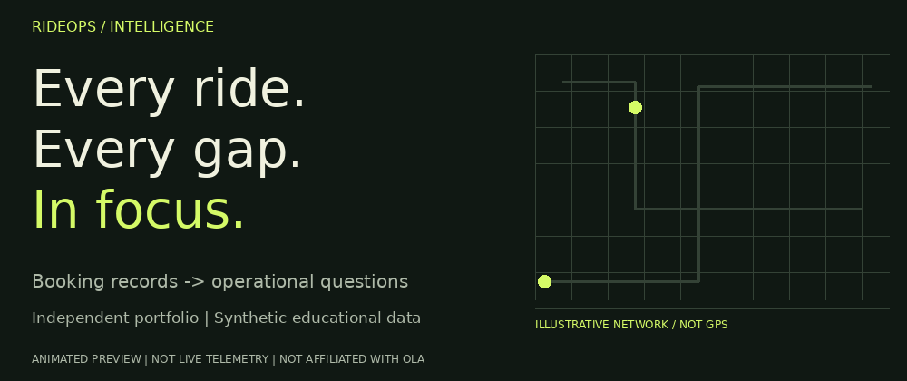
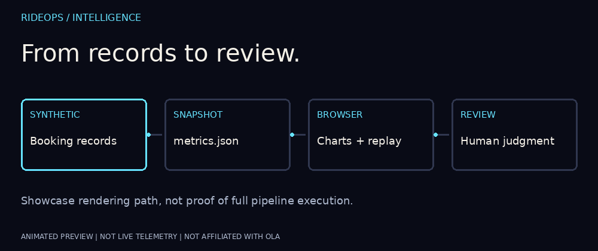
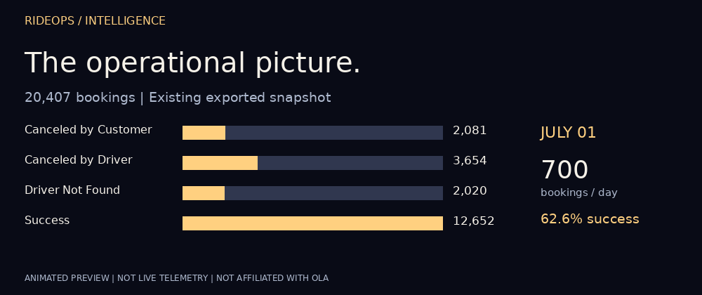

<!-- RIDEOPS_GIFS_START -->


## Architecture in motion


## Output preview


Synthetic educational data. Recorded snapshot animation, not a live service.

[Open interactive Control Room](https://AnyalstRushi.github.io/ola-rideops-intelligence/showcase/) — requires successful Pages deployment.

<!-- RIDEOPS_GIFS_END -->

# Ola RideOps Intelligence Platform

A mobility analytics portfolio turning synthetic booking records into an evidence-led operational story.

## Open the interactive experience

### [Launch RideOps Control Room →](https://AnyalstRushi.github.io/ola-rideops-intelligence/showcase/)

Animated network hero · interactive daily replay · booking-status charts · architecture narrative · print-to-PDF layout.

> Deployment target, not a verified live-status claim. The link works after the **Publish RideOps showcase** workflow succeeds and Pages is configured to use GitHub Actions. [View workflow runs](https://github.com/AnyalstRushi/ola-rideops-intelligence/actions).

[Existing dashboard source](index.html) · [Metrics snapshot](metrics.json) · [Showcase source](showcase/index.html)

> Synthetic educational data only, covering July 2024. Not affiliated with Ola. No real customer, driver, GPS, or operational feed. Animation replays stored aggregates; it is not a live backend.

## What to explore

| Experience | What it shows |
|---|---|
| Mobility hero | Illustrative network animation, not actual routes |
| Operational picture | Existing metrics.json values and status breakdown |
| Daily replay | Stored daily bookings and success rates with play/pause and a slider |
| Engineering story | Snapshot-to-browser flow and interpretation guardrails |

Snapshot outputs are descriptive, not independently audited or proof of settled revenue. Planned pipeline components are not presented as completed capabilities.

## Architecture

Repository design / roadmap:

```text
Raw CSV -> staging -> validation and quarantine -> cleaned core bookings
       -> PostgreSQL analytics marts -> Streamlit / Power BI -> operational decisions
```

Current showcase rendering:

```text
Existing metrics.json -> browser validation -> KPI/status charts + daily replay
```

## Data-quality principles

1. Raw source data is immutable.
2. Critical errors are quarantined, never silently discarded.
3. Exact duplicates are flagged and routed separately.
4. Booking IDs must match CNR followed by 10 digits.
5. Cancelled and driver-not-found rides are not completed revenue.
6. Revenue eligibility requires business-rule validation, not just counting booking values.

## Quick start

```bash
git clone https://github.com/AnyalstRushi/ola-rideops-intelligence.git
cd ola-rideops-intelligence
python -m venv .venv
# Activate the virtual environment for your operating system.
pip install -r requirements.txt
pytest -q
```

Preview the showcase from the repository root:

```bash
python -m http.server 8000
# Open http://localhost:8000/showcase/
```

For containerised local services:

```bash
docker compose up --build
```

## Repository layout

```text
src/ola_rideops/   Python pipeline modules
tests/             Unit tests
sql/               PostgreSQL schema and analytics SQL
docs/              Business, quality, KPI and architecture documentation
data/sample/       Synthetic sample data
showcase/          Interactive browser showcase
assets/            Repository presentation assets
.github/workflows/ CI and Pages publishing
```

## Roadmap and completion boundaries

- [x] Repository foundation and quality-rule specification
- [x] Initial booking-ID/status standardisation tests
- [x] Interactive snapshot showcase source
- [ ] Full CSV profile and reconciliation report
- [ ] Full null, duplicate and business-rule quarantine pipeline
- [ ] Postgres analytics marts and KPI reconciliation
- [ ] Streamlit dashboard
- [ ] Risk-scoring experiment and model card
- [ ] Editable PPTX and standalone PDF presentation
- [ ] Verified public deployment and browser QA

## Deployment

Set **Settings → Pages → Build and deployment → Source → GitHub Actions**. The publishing workflow uploads only an allowlisted static site, not the CSV dataset or application secrets. It does not run the Python backend. The Python CI remains separate; successful publishing is not evidence that unit tests passed.

## License

MIT intended; see LICENSE when added.
